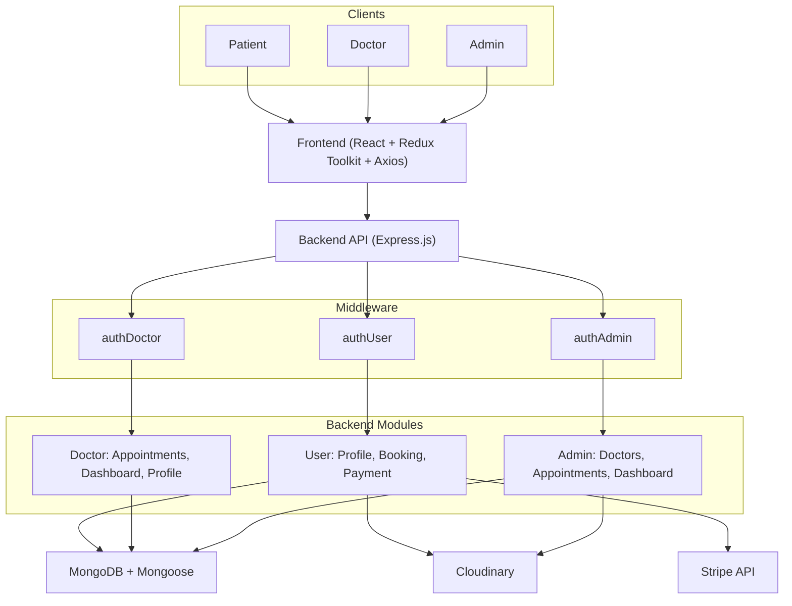
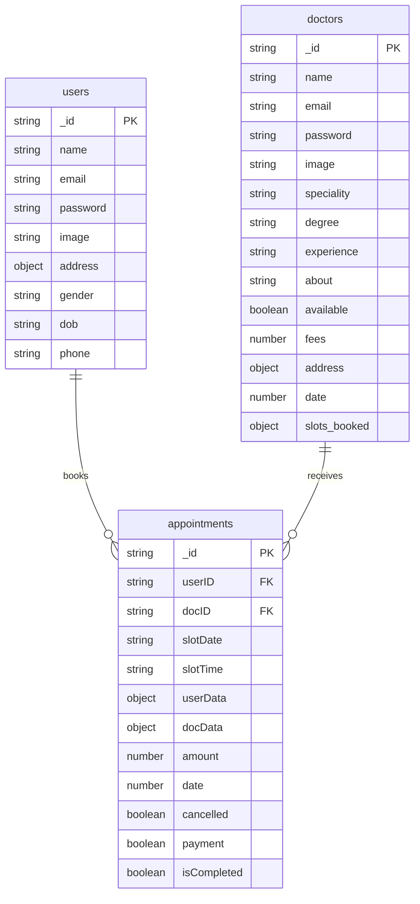
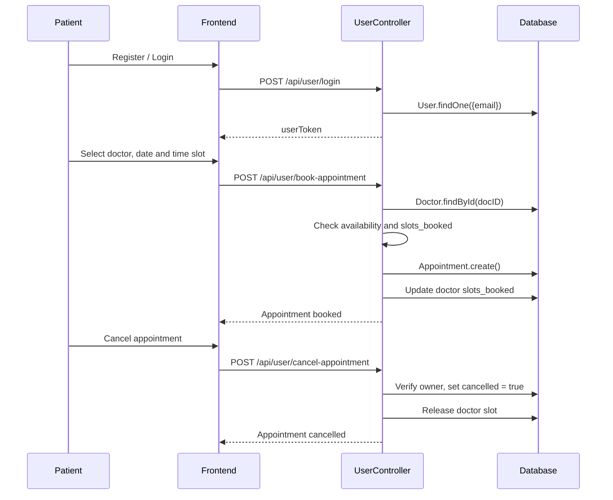
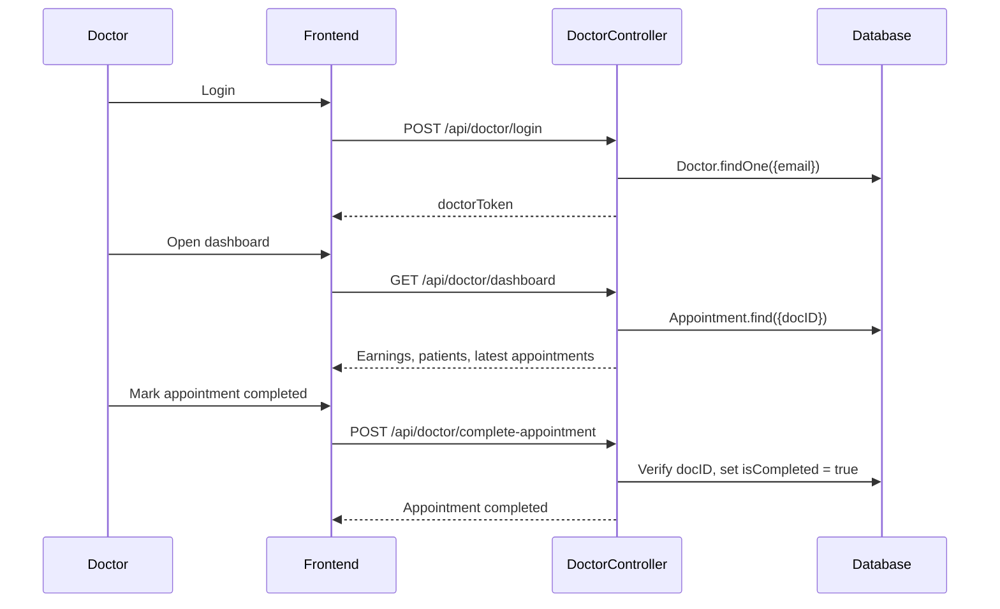
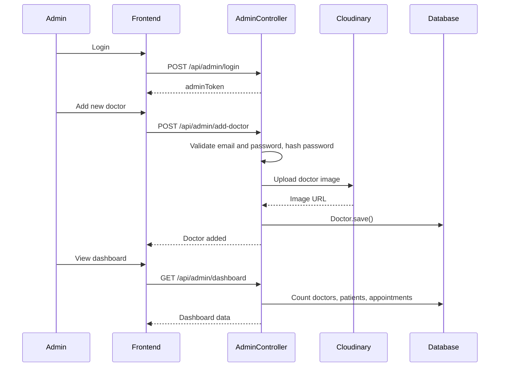
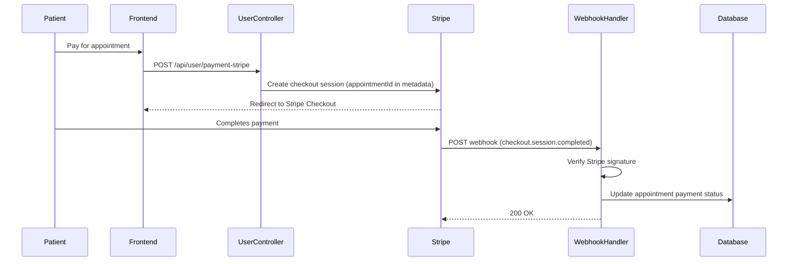

# Case Study - Doctor Management System: Role-Based Appointment Booking with Stripe Payments

## Overview

Meet the **Doctor Management System**.

A full stack appointment booking platform with three separate roles, where patients book time slots with doctors and pay online through Stripe, doctors manage their own schedule and earnings, and an admin oversees the whole system.

Patients register, browse the doctor list, pick a date and time slot, and book an appointment. Each doctor keeps a record of booked slots, so a time that is already taken cannot be booked twice. Doctors log in to a separate panel to complete or cancel appointments, track earnings, and update their fees, address, and availability. An admin adds new doctors, controls availability, and monitors every appointment from a dashboard.

Payment status isn't set from the client. A Stripe webhook verifies the checkout and updates the appointment on the server, so confirmation doesn't depend on the patient's browser returning to the app.

## Goals of the Project

The goal of this platform is to digitize the full appointment cycle between patients and clinics: discovering doctors, booking a slot, paying online, and managing the visit afterwards. A second goal was to practice multi-role architecture, with three independent login flows, separate route groups, and separate frontend state for each role.

## System Architecture Overview

### System Architecture Diagram

Patients, doctors, and the admin share one React frontend and one Express API. The API is split into user, doctor, and admin modules, each guarded by its own authentication middleware, with MongoDB for data, Cloudinary for images, and Stripe for payments.

---

## Key Features

### Three-Role User System

This platform provides 3 main user roles according to the clinic workflow.

- **Patient**: Register, manage profile, book and cancel appointments, pay online
- **Doctor**: Manage appointments, track earnings, update fees, address, and availability
- **Admin**: Add doctors, control availability, monitor all appointments and platform totals

### Appointment Booking

- **Slot-based booking**: Patients choose a date and a time slot with a doctor.
- **Double booking prevention**: Each doctor stores booked slots by date, and a slot that is already taken is rejected.
- **Availability check**: A doctor marked as unavailable cannot be booked.
- **Snapshot data**: Each appointment stores a copy of the patient and doctor details at the time of booking.
- **Slot release**: When a patient or the admin cancels an appointment, the doctor's slot is freed for someone else.

### Payment Processing

- **Stripe Checkout**: Patients pay for an appointment through a secure Stripe checkout session.
- **Webhook verified**: A webhook listens for `checkout.session.completed` and updates the appointment from the server side.
- **Cancelled appointments blocked**: A cancelled appointment cannot be sent to checkout.

### Authentication

- **JWT authentication**: Separate login flows and tokens for patients, doctors, and the admin.
- **Role-based middleware**: `authUser`, `authDoctor`, and `authAdmin` protect each group of routes.
- **Admin credentials**: Admin access is controlled through environment variables, not a database record.

### Patient Features

- **Profile management**: Update name, phone, date of birth, gender, address, and profile picture.
- **My appointments**: View booked appointments and their status.
- **Cancel appointments**: Cancel with an ownership check, so patients can only cancel their own bookings.

### Doctor Panel

- **Appointment management**: View assigned appointments, mark them completed, or cancel them.
- **Earnings dashboard**: Total earnings, appointment count, unique patient count, and the latest appointments.
- **Profile control**: Update fees, address, and availability.

### Admin Panel

- **Add doctors**: Create doctor accounts with a profile image uploaded to Cloudinary.
- **Doctor management**: View all doctors and toggle availability.
- **Appointment oversight**: View and cancel any appointment.
- **Platform dashboard**: Total doctors, patients, appointments, and the latest five appointments.

### API Architecture

**User (Patient)**
- `/api/user/register`
- `/api/user/login`
- `/api/user/get-profile`
- `/api/user/update-profile`
- `/api/user/book-appointment`
- `/api/user/appointments`
- `/api/user/cancel-appointment`
- `/api/user/payment-stripe`

**Doctor**
- `/api/doctor/list`
- `/api/doctor/login`
- `/api/doctor/appointments`
- `/api/doctor/complete-appointment`
- `/api/doctor/cancel-appointment`
- `/api/doctor/dashboard`
- `/api/doctor/profile`
- `/api/doctor/update-profile`

**Admin**
- `/api/admin/login`
- `/api/admin/add-doctor`
- `/api/admin/all-doctors`
- `/api/admin/change-availability`
- `/api/admin/appointments`
- `/api/admin/cancel-appointment`
- `/api/admin/dashboard`

### At a Glance

| Metric | Value |
|---|---|
| User roles | 3 |
| Dashboards | 2 (Doctor, Admin) |
| Payment | Stripe |
| Auth | JWT |

## Tech Stack

### Backend

**Frameworks & libraries**
- **Node.js**: For creating & running JavaScript on the server.
- **Express.js**: Light Node.js framework for backend logic.
- **MongoDB**: NoSQL database for storing data as scalable documents.
- **Mongoose**: Object modeling for MongoDB.
- **JWT**: Secure, role-specific authentication based on tokens.
- **bcrypt**: Password hashing before storage.
- **validator**: Email format validation.
- **Stripe**: Payment gateway for secure transactions and webhook verification.
- **Multer**: Handles image file uploads before they are sent to cloud storage.

### Frontend

**Frameworks & libraries**
- **React**: For building the patient, doctor, and admin interfaces.
- **Redux Toolkit**: Separate slices for user, doctor, and admin state, with async thunks for API calls.
- **Axios**: For API requests to the backend.
- **React Toastify**: For user friendly notifications.

### File & Media Handling

- **Cloudinary**: Stores doctor and patient profile images, so files are not kept on the server.

## Challenges & Solutions

| Challenge | Solution |
|---|---|
| Two patients could try to book the same time slot with the same doctor. | Each doctor stores a `slots_booked` object keyed by date, and the booking endpoint rejects a slot that is already in the list. |
| A cancelled appointment would keep blocking the doctor's calendar. | Cancelling an appointment removes that time from the doctor's `slots_booked`, so the slot becomes available again. |
| Payment confirmation could be lost if the patient closes the browser after paying. | A Stripe webhook updates the appointment's payment status on the server, using the appointment ID stored in the checkout session metadata. |
| Doctors and patients could act on appointments that belong to someone else. | Doctor actions compare the appointment's `docID` with the token owner, and patient cancellation compares `userID`, so the action is rejected on a mismatch. |

## Database Design

Three collections cover patients, doctors, and appointments. An appointment links one patient to one doctor and keeps a snapshot of both.

---

### Patient Flow

Login issues a JWT, then booking checks the doctor's availability and slot before creating the appointment and saving the slot on the doctor.

---

### Doctor Flow

Doctors log in with their own credentials, and every action is checked against the appointments assigned to them.

---

### Admin Flow

The admin signs in with environment-based credentials, and adding a doctor uploads the profile image to Cloudinary before the record is created.

---

### Payment Webhook Flow

Stripe confirms payment on its own, independent of whether the patient's browser makes it back to the app.

---

## Best Practices

### Authentication & Security

- **Password hashing**: Passwords for patients and doctors are hashed with bcrypt before storage.
- **Input validation**: Email format and minimum password length are checked on the server.
- **Role separation**: Each role has its own token, middleware, and route group.
- **Ownership checks**: Doctors and patients can only act on their own appointments.
- **Safe responses**: Passwords are excluded from profile responses, and the public doctor list hides doctor emails.
- **Webhook security**: Stripe webhook signatures are verified before any update is made.

### Data Integrity

- **Slot management**: Booked slots are stored per doctor and released on cancellation.
- **Snapshot data**: Appointments keep a copy of patient and doctor details at booking time.
- **Server side payment status**: Payment is confirmed through a verified webhook, not the client redirect.

### Media Handling

- **Cloud storage**: Profile images are uploaded to Cloudinary rather than stored on the server.